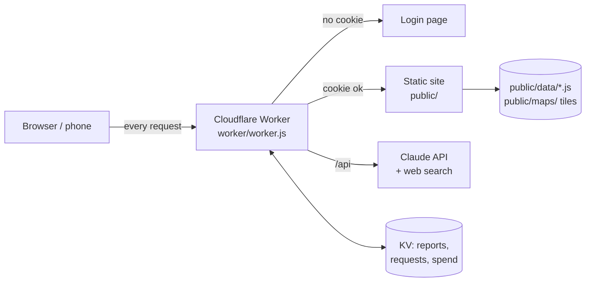
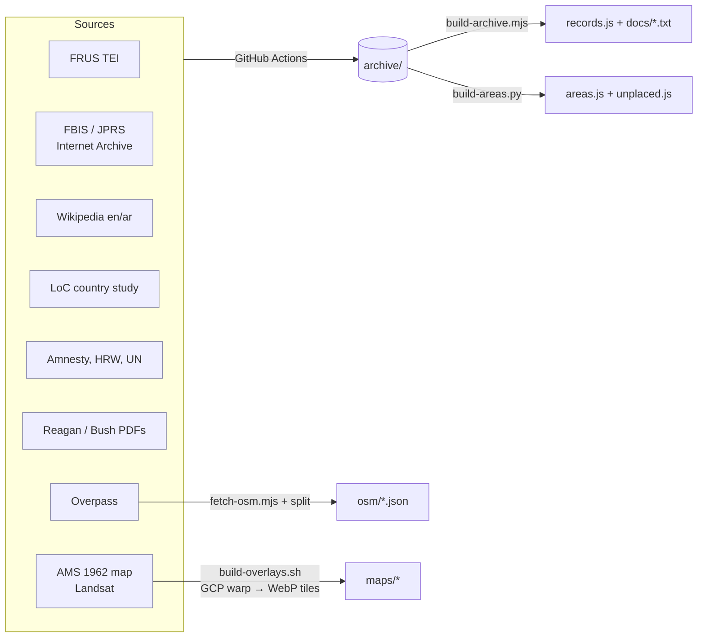
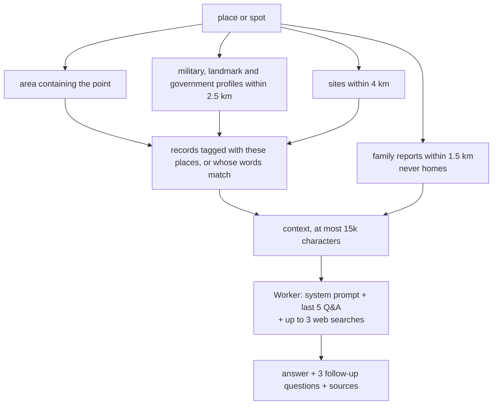

# Tripoli: Open Source

Private family map of Tripoli, Libya. It covers Gaddafi-era prisons, security sites, the military, the 1986 raid and killings, alongside landmarks, today's map data and an archive of 2,700+ documents. The site is password-protected, and an AI answers questions about any place.

## System



## Data model

```mermaid
erDiagram
  SITE ||--o{ RECORD : "tagged in (places)"
  AREA ||--o{ RECORD : "tagged in (places)"
  AREA ||--o{ SITE : "contains (distance)"
  SITE }o--o{ SITE : LINK
  REPORT }o--o| SITE : "note about (target)"
  REPORT }o--o| AREA : "note about (target)"
  ERA ||--o{ SITE : "filters (y0..y1)"
  OVERLAY }o--|| ERA : "dated (year)"
  SITE { string id; string layer; string level; float lat; float lon; float r_km; int y0; int y1 }
  AREA { string id; string kind; string summary; string history; string era; string today; list sources }
  RECORD { string i; string y_type; string d_date; string s_source; string r_rights; list p_places }
  REPORT { string id; string cat; string title; string text; string how; float lat; float lon; string target }
  OVERLAY { string id; int year; string tiles; bbox bounds }
  OSM_FEATURE { int id; string k_kind; map t_tags; geom g }
```

| Entity | File | Count |
|---|---|---|
| Site (curated event or place) | `public/data/sites.js` | 23 |
| Area (profile of a neighbourhood, building or camp) | `archive/areas/*` → `public/data/areas.js` | 138 (+57 without coordinates) |
| Record (document or event) | `archive/*` → `public/data/records.js` | 2,730 |
| Report (added by family) | Cloudflare KV `reports:v1` | live |
| OSM feature (today's map data) | `public/data/osm/*.json` | ~2,300 |
| Overlay (old map or satellite image) | `public/data/overlays.js` + `public/maps/` | 4 |

Evidence level is one of `documented`, `testimony`, `suspected` or `context`. Record rights is `public-domain` (full text shown), `cc-by-sa` (full text shown), or `link-only` (summary and link only).

## Pipeline



## Algorithms

**Asking about a place** (`contextFor` → Worker → Claude):



**Search ranking (Encyclopedia):** each query word scores +3 if it is in the title and +1 if it is in the body, plus +4 if the whole phrase is in the title. A year or year range filters results. Ties break by kind (place, then area, then event, then document) and then by date.

**Time filter:** a site is shown if it falls inside the selected era. If a year cursor is set, the site is shown if it starts on or before that year. It is bright while active (`y0 ≤ year ≤ y1`, or ±1 year for one-year events) and faded otherwise.

**Labels:** after each zoom or pan, labels are placed in priority order (sites, then districts), and any label whose box overlaps one already placed is hidden.

**Overlays:** IIIF scan → ground control points from the map's corner coordinates (ED50) → `gdalwarp` → WebP tiles, zoom 12–17.

## Run

Deploy: see `SETUP-AI.md`. Cloudflare builds from `wrangler.jsonc`, and the Worker needs the secrets `ANTHROPIC_API_KEY`, `FAMILY_CODE` and `OWNER_CODE`.

Rebuild the data locally:

```sh
node scripts/build-archive.mjs   # rebuilds records.js
python3 scripts/build-areas.py   # rebuilds areas.js
node scripts/fetch-osm.mjs       # refreshes osm/*.json
```

Rights: U.S. government works are public domain. Wikipedia text is CC BY-SA. Everything else is shown as a summary with a link.
