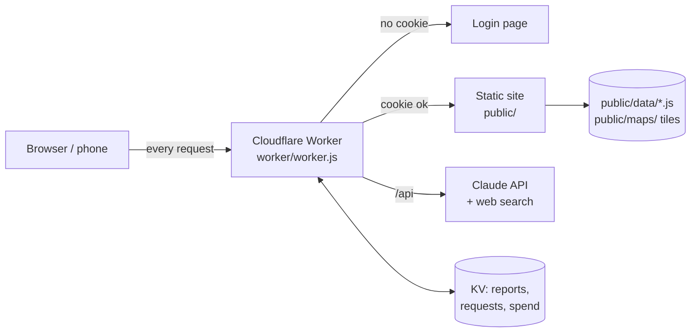
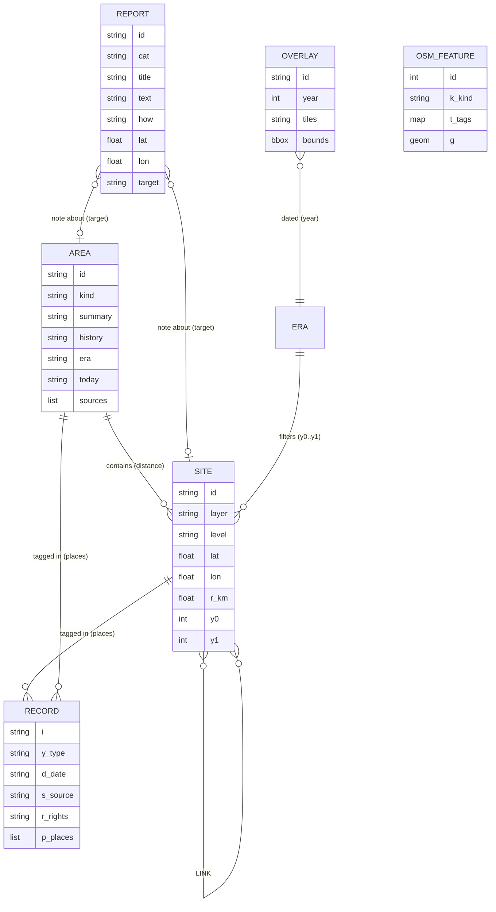
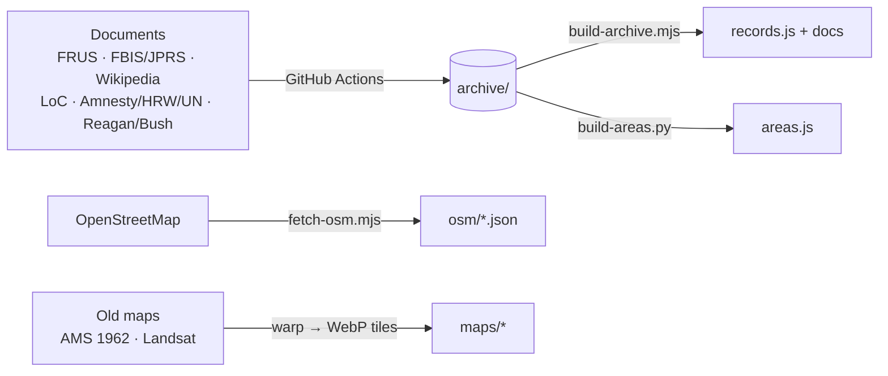
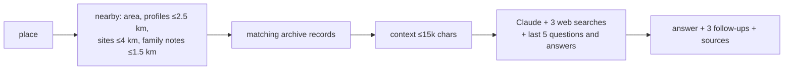

# Tripoli: Open Source

A record of Gaddafi's Tripoli, built from declassified files and the accounts of people who lived there. It maps prisons, security sites, military bases, the 1986 raid and the regime's killings, and backs them with 2,700+ documents. Password-protected. Ask the AI about any place.

## System



## Data model



| Entity | File | Count |
|---|---|---|
| Site (curated event or place) | `public/data/sites.js` | 23 |
| Area (profile of a neighbourhood, building or camp) | `archive/areas/*` → `public/data/areas.js` | 139 (+59 without coordinates) |
| Record (document or event) | `archive/*` → `public/data/records.js` | 4,290 |
| Connection (evidence-based link between two places) | `archive/research/links*.json` → `public/data/links.js` (`scripts/build-links.mjs`, `scripts/auto-links.py`) | 159 |
| Unknown entity (person, group or outside place linked in the files) | `archive/crest/extract*.jsonl` → `public/data/unknown.js` (`scripts/build-unknown.py`; free pictures via `scripts/unknown-photos.mjs`) | 285 entities, 268 links, 66 pictures |
| Report (added by family) | Cloudflare KV `reports:v1` | live |
| OSM feature (today's map data) | `public/data/osm/*.json` | ~2,300 |
| Overlay (old map or satellite image) | `public/data/overlays.js` + `public/maps/` | 4 |

Evidence level is one of `documented`, `testimony`, `suspected` or `context`. Record rights is `public-domain` (full text shown), `cc-by-sa` (full text shown), or `link-only` (summary and link only).

## Pipeline



## Algorithms

**Asking about a place** (`contextFor` → Worker → Claude):



**Search ranking (Encyclopedia):** each query word scores +3 if it is in the title and +1 if it is in the body, plus +4 if the whole phrase is in the title. A year or year range filters results. Ties break by kind (place, then area, then event, then document) and then by date.

**Time filter:** a site is shown if it falls inside the selected era. If a year cursor is set, the site is shown if it starts on or before that year. It is bright while active (`y0 ≤ year ≤ y1`, or ±1 year for one-year events) and faded otherwise.

**Labels:** after each zoom or pan, labels are placed in priority order (sites, then districts), and any label whose box overlaps one already placed is hidden.

**Overlays:** IIIF scan → ground control points from the map's corner coordinates (ED50) → `gdalwarp` → WebP tiles, zoom 12–17.

## Run

Deploy: see `SETUP-AI.md`. Cloudflare builds from `wrangler.jsonc`, and the Worker needs the secrets `ANTHROPIC_API_KEY`, `FAMILY_CODE` and `OWNER_CODE`.

Rebuild the data locally:

```sh
node scripts/build-archive.mjs   # rebuilds records.js
python3 scripts/build-areas.py   # rebuilds areas.js
node scripts/fetch-osm.mjs       # refreshes osm/*.json
```

Rights: U.S. government works are public domain. Wikipedia text is CC BY-SA. Everything else is shown as a summary with a link.


## The Unknown

A map style that swaps the city for a black plane: the people, organisations and places beyond Tripoli that the declassified files connect
(for example the Edwin Wilson and Frank Terpil arms network). Names and links come from the Claude Haiku extractions; spellings are merged in
`scripts/build-unknown.py`. Where Wikimedia Commons has a freely licensed photo or drawing of the same entity (checked against a Wikipedia
article that mentions Libya), it is shown with its credit; everything else gets a drawn stand-in, never a likeness.
Rebuild with `python3 scripts/build-unknown.py`; refresh pictures by running the "Find free pictures for The Unknown" workflow.
