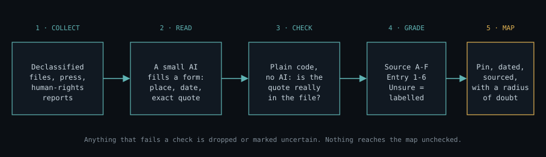
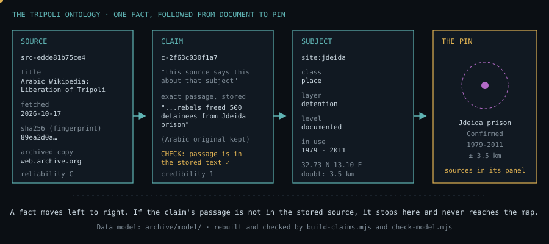
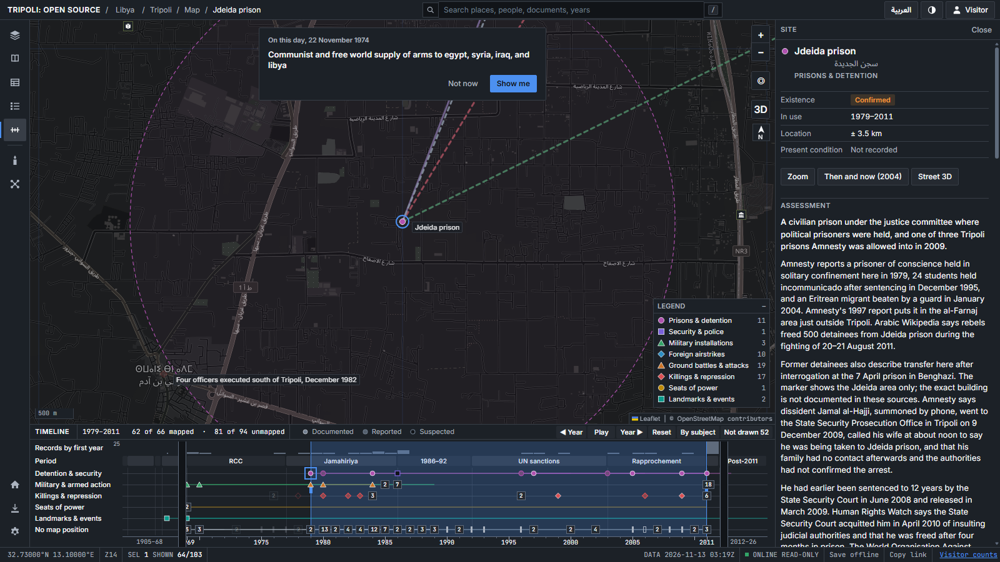
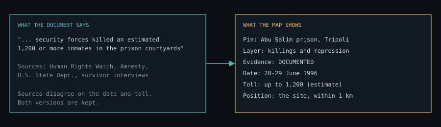
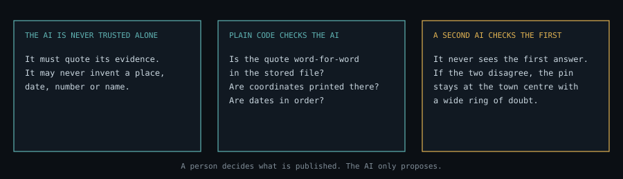

# TRIPOLI: OPEN SOURCE

**A sourced map of Libya under Gaddafi, 1969–2011.** Every pin says what happened, when, and exactly which document says so. It was built for one family looking for the truth about their country, and it is open to anyone.

## In one minute (no computer science needed)

Imagine a huge pile of old paper: American intelligence files, translated Libyan radio, human-rights reports, survivors' interviews. Nobody can read it all.

This project does four plain things with that pile:

1. **Reads it** with a small AI that fills in a form: *where, when, what, and the exact sentence that proves it.*
2. **Checks the AI** with ordinary code. If the "exact sentence" is not really in the document, the finding is thrown out.
3. **Admits doubt.** Every pin carries an evidence level and a grade. If only the town is known, the pin sits on the town with a wide circle, not a falsely precise dot.
4. **Puts it on a map**, laid over declassified spy-satellite film from 1966, 1972, 1976 and 1983, so you can see the same ground then and now.

## The Tripoli Ontology

An **ontology** is just the agreed list of *things* the system knows about and how they connect. This project calls its own list **the Tripoli Ontology**. It has three kinds of thing:

| Object | Plain meaning | Real example |
|---|---|---|
| **Source** | One document, stored with a fingerprint | `src-edde81b75ce4`: Arabic Wikipedia, "Liberation of Tripoli (2011)", fetched 2026-10-17 |
| **Claim** | "This source says this about that subject", with the exact passage | `c-2f63c030f1a7`: "...rebels freed 500 detainees from Jdeida prison" |
| **Subject** | A place, event or connection on the map | `site:jdeida`: Jdeida prison, detention, 1979–2011, ±3.5 km |

The **claim** is the link. A subject exists on the map only because claims from sources back it. Today the Ontology holds 742 sources, 1,383 claims and 822 subjects (`archive/model/`).

## One fact, followed all the way

1. **Source.** The document is stored whole, with a fingerprint and an archived copy.
2. **Claim.** The exact sentence is copied out beside it. Code then confirms that sentence is really in the stored text (`check-model.mjs`). If it is not, the claim is rejected.
3. **Subject.** The claims about one place are gathered into one subject, with its layer, evidence level, years and position.
4. **Pin.** The subject is drawn on the map. Clicking it shows its text and every source behind it.

## The final product

Here is the same fact on the live map: Jdeida prison, with its circle of doubt, the evidence level, the sources in the panel, and the timeline below.

## What you can do with it

| You want to… | Use… |
|---|---|
| See what happened where | A pin. Layers: detention, security, military, airstrikes, battles, killings and repression, power, landmarks |
| See the city as it was | The old-film layers (1966 · 1972 · 1976 · 1983) against today's imagery |
| Follow events in order | The timeline: drag the year and pins appear and fade |
| Know how sure we are | The grade beside each source (A–F) and each entry (1–6) |
| See who is linked to whom | The link view of people, places and organisations |
| Search | English or Arabic |

## Reading one pin

Where sources disagree, the pin says so and keeps both versions.

## Why you can trust it (and where you cannot)

- **Documents are kept** privately (they are not published in this repository), so every check runs on the real text, not on a model's memory.
- **Locations** come only from coordinates printed in a document or from a published reference. A model never supplies a coordinate.
- **Private people** named only in diplomatic cables are not published by name.
- **Limits, stated plainly.** The checks prove a quotation is real, not that its source is right. Most sources are American or translated Libyan state media. Where one publisher alone reports a killing, the pin says "reported, not confirmed".

## What is in this repository

| Folder | Plain meaning |
|---|---|
| `public/` | The website itself: map, pins, panels, icons |
| `scripts/` | The checking and building tools. `node scripts/preflight.mjs` runs every check before anything is published |
| `worker/` | The small server that keeps the family sign-in and AI guide private |
| `.claude/agents/` | Seven narrow AI helpers that propose reviews. None can publish |
| `ARCHITECTURE.md` | The technical reference, for engineers |

## Keys and secrets

None are in this repository. The AI guide needs three secrets (`ANTHROPIC_API_KEY`, `FAMILY_CODE`, `OWNER_CODE`) that live only in the hosting dashboard. See `SETUP-AI.md`. `node scripts/check-secrets.mjs` scans every tracked file and runs in preflight.

## Sources and rights

U.S. government works are public domain. Wikipedia text is CC BY-SA. Everything else is shown as a short summary with a link to the original.
